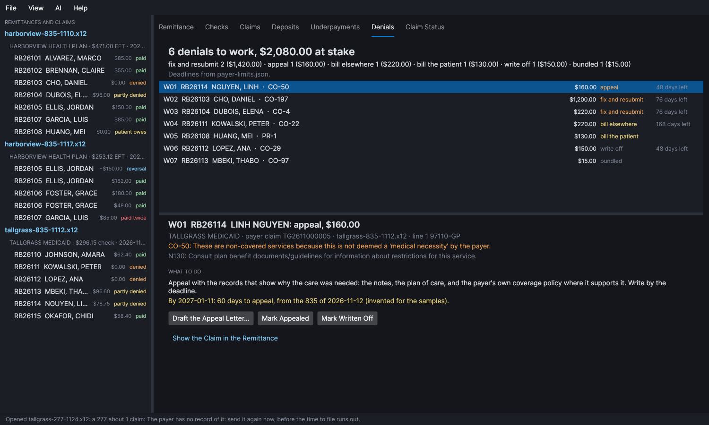
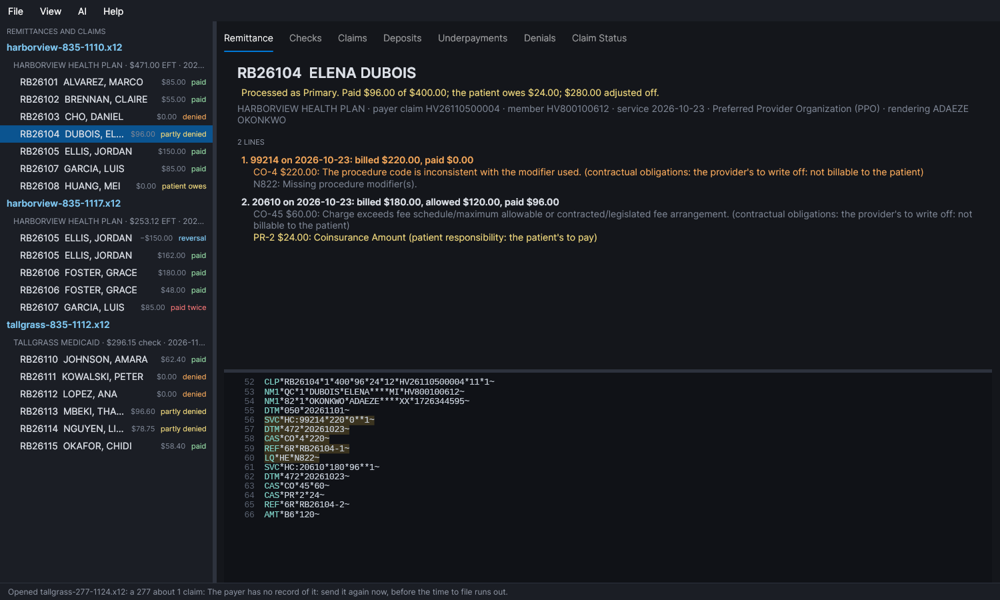
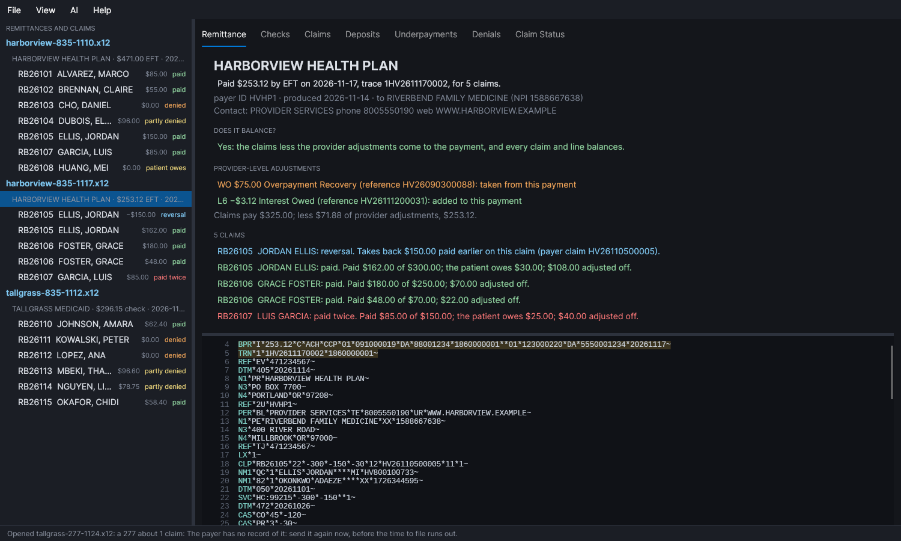
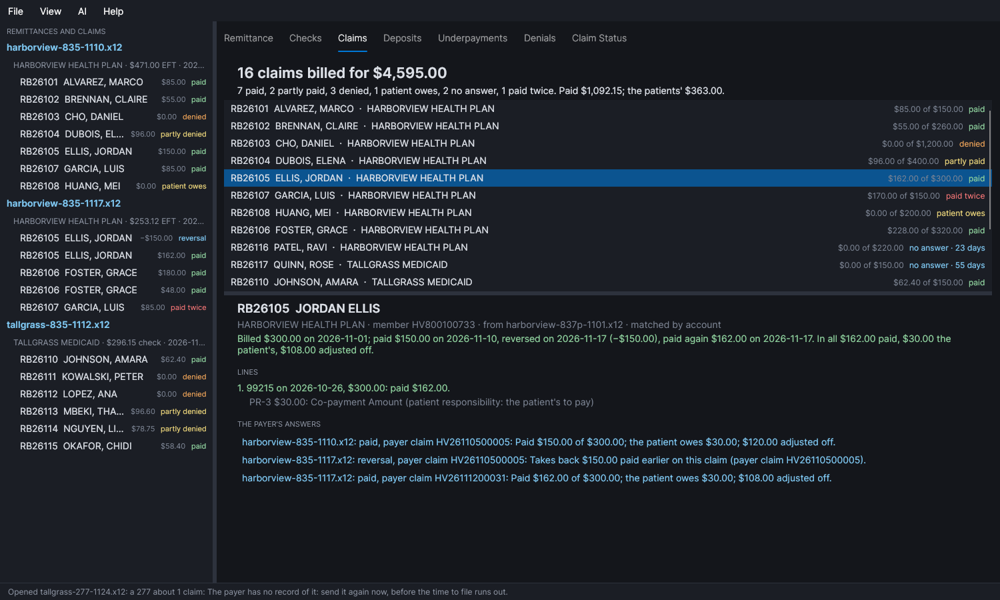
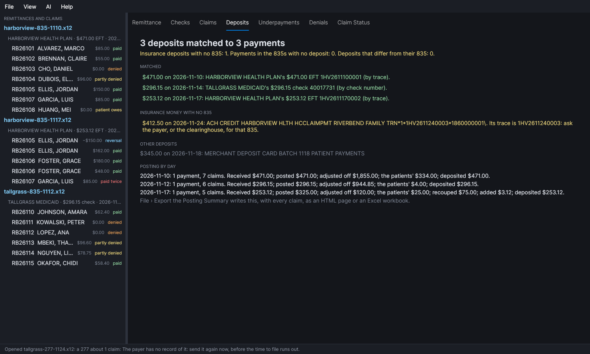
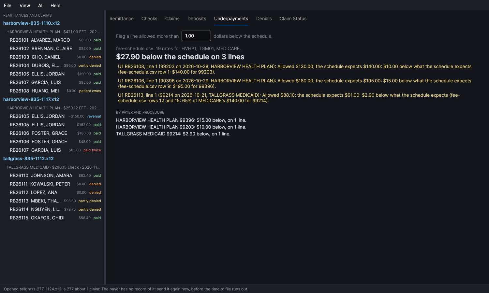
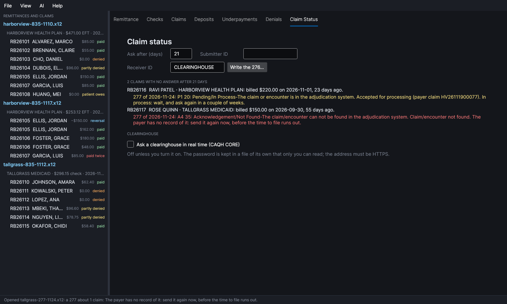
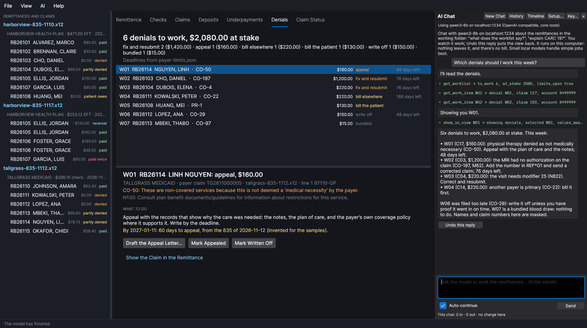
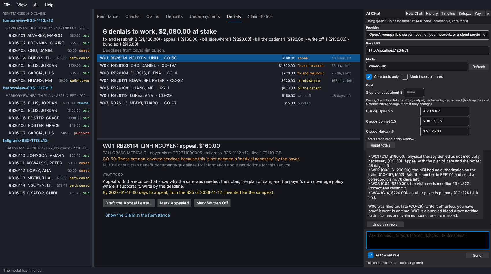

# AVA Remittance

Know what the payer paid, and why. AVA Remittance reads HIPAA **835** remittances (005010X221A1) and says, claim by
claim and line by line, what was billed, allowed, paid, adjusted off and left to the patient, in plain words. Every
reason and remark code is read from X12's published lists. Then it does the back office's work:

- matches each claim you **billed** to its payments: a reversal and its correction, a claim the payer split, a claim
  paid twice, a claim with no answer yet;
- matches each payment to the **bank's deposit**;
- flags lines allowed **below your fee schedule**;
- keeps every **denial** as a work item, with what to do and the days left to do it.

It also asks about claims with no answer (**276/277**), by file or in real time over **CAQH CORE**, off until you set it up.

It has an **AI Chat** (F12) and an **MCP server**, so Claude or a model on your own computer can go through the
denials, explain why a claim was paid less, or find what's unmatched at the bank. **Agents see people's details
masked** unless you say otherwise. See [AI: the chat and agents](#ai-the-chat-and-agents).



## Download

Builds for Windows, macOS and Linux (Intel/AMD and ARM) are on the
[releases page](https://github.com/Harlock123/AVARemittance/releases). Unzip or untar and run `AVARemittance`
(`AVARemittance.exe` on Windows); nothing else needs installing.

## Reading a remittance

Open 835s (File › Open, or drop them on the window). The list shows each payment with the claims it pays, each marked
paid, partly denied, denied, patient owes or reversal. Choose a payment to see:

- the money, and the trace or check number;
- the payer's provider-level adjustments: a recoupment taken, interest added;
- whether it balances.

Choose a claim to see each line and each adjustment, with whose it is to pay:

> CO-45 $60.00: Charge exceeds fee schedule/maximum allowable or contracted/legislated fee arrangement. (contractual
> obligations: the provider's to write off: not billable to the patient)

Clicking a line highlights the segments it came from.



The **Checks** tab says whether each 835 balances:

- the payment against its claims and provider adjustments;
- each claim against its adjustments and its lines;
- each line;
- the patient's share against the PR adjustments;
- the segment count.

Each problem comes with the rule, why it matters and its source. An 835 that doesn't balance shouldn't be posted as it
stands.



## What was billed, and what came back

Open the **837s** you sent (837P or 837I), or a **charges list**: a CSV or Excel file with one row per line. Its
columns are found by name: Account, Payer ID, Payer, Last name, First name, Member ID, Birth date, Date of service,
Procedure, Modifiers, Units, Charge, Billed. The **Claims** tab matches each billed claim to its payments, by the
account the 835 sends back, or else by patient, date and charge. Each line is matched by its control number, or by its
code and date. Every claim is marked:

- **paid**, **partly paid**, **denied**, or **patient owes** (all of it to the deductible);
- **reversed**: the payment was taken back with nothing in its place yet. A reversal followed by a new payment is a
  correction, and the tab says what changed;
- **paid twice**: the same line paid in two payments, and how much too much;
- **no answer**, with the days since it was billed.

A claim the payer split into two shows as one claim, with both payments. Each line says what paid it, or that it was
bundled into another. Claims in the 835s that nothing open billed are listed too.



## The money

Open a **bank statement**: a CSV or Excel file (Date, Description, Amount or Credit and Debit, Reference), or the
BAI2 file most banks give. The **Deposits** tab matches each deposit to its 835, by the trace number the EFT carries
(the TRN in its addenda) or the check number, or else by amount within a week. It lists:

- insurance money with no 835, with its trace number to ask for the 835;
- 835 payments with no deposit;
- a deposit that differs from its 835, and which recoupment or interest the difference matches, when one does.

Below the matches is the **posting summary** by day:

- received;
- posted to claims;
- unapplied (paid on claims nothing open billed);
- adjusted off;
- the patients' share;
- recouped;
- interest added;
- deposited.

**File › Export the Posting Summary** writes it, with every claim, as an HTML page or an Excel workbook.



## Underpayments

Open a **fee schedule**: a CSV or Excel file with Payer, Procedure, Modifier and Rate (and From and To when a rate
changes). A payer that pays a share of another schedule gets a row with Procedure `*`, a Percent and a Basis (65 of
MEDICARE). The **Underpayments** tab flags:

- every line allowed more than the tolerance below what the schedule expects, and which rows that rests on;
- lines whose own amounts don't agree (allowed, paid and the patient's share);
- a contractual write-down larger than the schedule explains.

Below that is each payer's total below the schedule, by procedure.

A flag says "below what the schedule expects", never "wrong": the schedule is yours, and the contract decides.



## Denials

The **Denials** tab lists every denial in the open 835s as a work item, sorted by what its reason and remark codes
point to:

- **fix and resubmit**: a missing modifier, a missing authorization, information the payer says is missing or
  invalid, with what to change;
- **appeal**: medical necessity and the like, with the records to send;
- **bill elsewhere**: another payer is primary, or this one isn't the patient's;
- **bill the patient**: what the plan leaves to the patient (all of it to the deductible, or not covered);
- **write off**: filed too late (unless there's proof it wasn't), or not covered and not billable to the patient;
- **bundled**: paid within another line, which needs nothing unless a modifier should have kept it separate.

Contractual write-downs and routine copays aren't denials and aren't listed. Open the payers' limits (a JSON file of
appeal, corrected-claim and timely-filing days for each payer) and each item shows the days left, counted from the
835's payment date.

For an item you can:

- **Draft the Appeal Letter**: Word, HTML or Markdown, with the claim, the codes in words and the argument they call
  for. It's marked as a draft, with [brackets] where only you can fill in.
- **Corrected Claim Changes**: frequency 7, the payer's claim number in REF*F8, and what to fix.
- **Check Eligibility Again**, for a denial a fresh 271 answers: another payer first (CO-22), not covered on the
  dates (CO-26, CO-27), or the patient not found (CO-31). It saves the claim as an appointment list for
  [AVA Eligibility](https://github.com/Harlock123/AVAEligibility) (1.1 and later), with the date of service as the visit
  date and the denial in a column of its own, and opens it there. AVA Eligibility writes the 270 for that date (or asks
  in real time) and says what the answer means for the denial: it agrees (coverage had ended: bill the plan that
  covered the patient then, or the patient), it doesn't (coverage was active: ask the payer to reprocess, or appeal
  with the 271), or it shows why the claim didn't match (the payer has another member ID). **File › Check Eligibility
  Again for the Coverage Denials** does every open one at once; **File › Where AVA Eligibility Is** points it at the
  program when it isn't on the PATH. The birth date and sex come from the 837 or charges list the claim was billed on.
- **Mark** it appealed, resubmitted, billed elsewhere, billed to the patient or written off, or reopen it. This is
  kept in `remittance-work.json` beside the 835s.

**File › Export the Denials** writes the worklist as HTML or Excel. Nothing is ever sent.

## Claim status

**Claim Status** lists the billed claims with no answer after so many days (21 unless you change it). **Write the
276** writes the claim status request for them, one transaction per payer. Open the **277s** that come back, and each
claim shows where it stands and what to do: in process, received, rejected, or not found ("send it again now, before
the time to file runs out").



You can also ask a clearinghouse in real time over CAQH CORE connectivity, by HTTP MIME multipart or SOAP with
WS-Security:

- Sending is off until you turn it on.
- The address must be HTTPS.
- **Ask Now** asks you first, saying how many claims and where.
- Each 277 is saved beside the billed claims and opened.
- The password is kept in a file of its own that only you can read.
- The tests only ever talk to a mock clearinghouse on the test machine itself.

## AI: the chat and agents

**AI › AI Chat** (F12) opens a chat on the right. It works with Claude (an Anthropic API key) or with a model on your
own computer or network: Ollama, LM Studio, any OpenAI-compatible server, or a local server that speaks Anthropic's
Messages API. It can use every tool, or a core set for small models. Undo this reply puts the view back.



**Agents see people's details masked.** These are masked to their shape wherever they turn up, whether in a
finding, a deposit's description or a raw segment:

- every patient name and member ID;
- patient accounts, payer claim numbers and line control numbers;
- check and trace numbers, and bank accounts.

`RB26104` becomes `R*99999`, so an agent can still see what kind of value it is. Every date keeps only its year.
Agents refer to things by handle: R01 payments, C01 claims, B01 billed claims, W01 denials, D01 deposits, P01
patients.

Payers, providers, codes and amounts aren't people's details and are shown. **AI › Let AI Agents See Values** turns
masking off; use it only with a model your organisation may send PHI to. Starting with `--mask` keeps masking on
whatever the setting says. Some things stay with you whatever an agent asks:

- Reports and appeal drafts that agents write are masked unless values are allowed.
- Writing a 276 needs values allowed.
- Recording what was done with a denial runs only in the open window.
- Asking the clearinghouse runs only in the open window, after your yes.

Outside agents (Claude Code, Claude Desktop, any MCP client) connect in three ways:

```bash
# Attached to the open window (AI › Allow AI Agents must be on): the agent works on what's open there.
claude mcp add avaremittance -- /path/to/AVARemittance --mcp --attach

# Headless, on a folder of 835s, 837s, statements and schedules.
claude mcp add avaremittance -- /path/to/AVARemittance --mcp --root /path/to/files

# Over the network, with a token (AI › Connect an Agent in the window, or headless):
AVARemittance --mcp --http 8780 --root /path/to/files [--token TOKEN] [--cert CERT --key KEY]
```



| Tool | What it does |
|---|---|
| `list_files`, `open_file`, `close_file`, `list_open` | The files in the working folder, by kind; open and close them |
| `list_payments`, `get_payment`, `get_claim`, `get_segments`, `check_balance` | The payments and their claims; a payment or claim in words, line by line; the raw segments; whether each 835 balances |
| `explain_code`, `search_codes` | Any CARC, RARC, group, PLB, claim status or 277 code's meaning (and what a denial with it asks for); codes by words |
| `list_billed`, `get_billed` | The billed claims matched to the 835s; one against its answers, line by line |
| `get_deposits`, `posting_summary`, `export_posting` | The deposits against the payments; what to post by day; the posting report (`.html` or `.xlsx`, masked unless allowed) |
| `get_underpayments` | Lines below the fee schedule and each payer's total by procedure (with a what-if tolerance) |
| `get_worklist`, `get_work_item`, `draft_appeal`, `corrected_claim`, `mark_work`, `export_denials` | The denials and one in full; an appeal draft; a corrected claim's changes; record what was done (the open window only); the denials report |
| `write_eligibility_recheck` | The coverage denials (CO-22, 26, 27, 31) as AVA Eligibility's appointment list, for a fresh 271 on the date of service (values allowed only) |
| `claims_waiting`, `get_status`, `write_status_request`, `ask_clearinghouse` | The claims with no answer; the 277s; the 276 (values allowed only); asking in real time (the open window only, after your yes) |
| `get_view`, `show_in_view`, `render_view` | What the window shows; select a payment, claim or denial there; a picture of one |
| `batch`, `get_recording`, `save_steps`, `run_steps` | Several calls at once; keep a session's calls and run them again |
| `checkpoint`, `diff`, `render_checkpoint`, `restore_checkpoint` | Remember what's open and the view, see what changed, go back |

Recipes (MCP prompts):

- the day's posting;
- why a claim was paid less;
- which denials to appeal this week;
- draft an appeal;
- what's unmatched at the bank;
- a payer's underpayments;
- claims with no answer;
- the denials report.

Each is run call by call in the tests.

## Command line

```bash
AVARemittance [files or folders…] [--real | --mask]   # open 835s, 837s, statements, schedules; what agents see
AVARemittance --mcp [--attach] [--root FOLDER] [--real | --mask] [--http [ADDRESS:]PORT …]
```

## Samples

`samples/` holds an invented family clinic's work, made by `make_samples.py`:

- the 837Ps it sent;
- the 835s its two invented payers sent back;
- `charges/`: the same claims as a charges list;
- `bank/`: November's statement, as CSV and BAI2;
- `contracts/`: its fee schedule and its payers' limits;
- `status/`: the 276 for the claims with no answer, and the 277s that answered it;
- `problems/`: an 835 that doesn't balance;
- `recheck/`: three claims a payer denied for coverage (coverage ended, the patient not found, before coverage began),
  their 837 and 835, and the list Check Eligibility Again writes for them.

Each claim has one situation planted:

- a copay;
- a deductible;
- a missing authorization;
- a missing modifier;
- a reversal and its correction;
- a claim the payer split;
- a claim paid twice;
- all of it to the deductible;
- coordination of benefits;
- timely filing;
- a bundled line;
- medical necessity;
- an underpayment;
- no answer yet.

Every person, payer, account, member ID, NPI, tax ID, bank account, check and trace number is made up.

## What it isn't

It isn't a practice-management system, a clearinghouse or a bank connection:

- It doesn't post to anyone's ledger: it gives you the posting and the export.
- It doesn't send appeals or corrected claims: drafts are drafts.
- It reads only 005010X221A1 835s and 005010X212 277s.
- A fee-schedule comparison is only as right as the schedule you load, and the deadlines only as right as your payers'
  limits.

AVA Claim Scrubber checks claims before they go. AVA Eligibility checks coverage before the visit.

## Building

```bash
dotnet build AVARemittance.slnx
dotnet test AVARemittance.slnx
REMIT_SHOTS=$PWD/Screenshots dotnet test --filter Screenshots     # these pictures
cd samples && python3 make_samples.py                             # the samples
python3 tools/make_codes.py                                       # the CARC, RARC and 277 status lists, from x12.org
```

.NET 10 and Avalonia 11.3. `AGENTS.md` has how the code is put together.

## License

MIT
